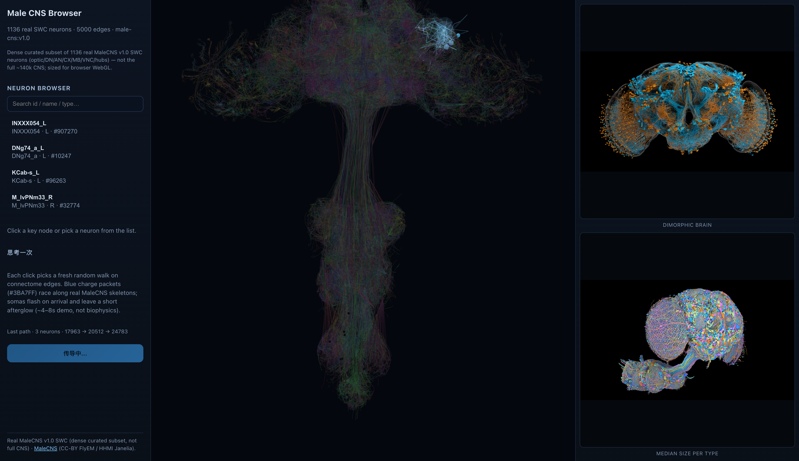

# Male CNS Browser

**Live demo:** [https://male-cns-browser.vercel.app](https://male-cns-browser.vercel.app)

Open-source **3D fruit-fly CNS neuron browser** for exploring a dense MaleCNS-shaped connectome subset, inspecting key nodes, and playing a blue “think once” lightning pulse along a fresh random connectome walk each click.

> Visual demo only — not a biophysical spike model. Ships a **real MaleCNS v1.0 SWC subset** (no neuPrint token required at runtime).


## Deploy (Vercel)

Repo root `vercel.json` builds the Vite app in `web/` (`npm ci` + `npm run build` → `web/dist`) and serves `api/kimi` as a serverless function. `subset.json` is ~21MB static data.

```bash
vercel link   # once
vercel env add KIMI_API_KEY
vercel --prod
```

## Quick start

```bash
cd web
npm install
npm run dev
```

Then open the printed local URL (usually `http://localhost:5173`).

```bash
npm test    # Vitest
npm run build
```

## Features (v0.1)

- 界面文案为**中文**（侧栏 / 按钮 / 说明 / 参考图标题）
- Orbit a dark-background 3D scene of **real MaleCNS SWC skeletons** (rainbow by type), auto-fitted and slowly auto-rotating
- Click key nodes (somas) to see id / type / side and neighbors
- Press **思考一次** for a random edge walk: **blue lightning** (`#3BA7FF` / `#5B9FFF`) crackles along real arbors (jagged bolt, flicker, tip branches), somas flash on arrival, then a short afterglow (~0.75s); demo window about **4–8s** (not biophysics)
- **AI 查询（问 AI）**：选中神经元后可提问类型含义 / 功能科普；密钥经本地 Vite `/api/kimi` 代理，**不会**进浏览器（见下）
- Right-hand panel: Janelia reference renders (local copies; see below)
- `ConnectomeSource` abstraction with `LocalJsonSource` today; optional neuPrint enrich via `scripts/prepare/enrich_neuprint.py`

## Shipped subset (current)

Committed `web/public/data/subset.json` meta (exported 2026-10-20):

| | |
| --- | --- |
| Dataset | `male-cns:v1.0` |
| Neurons | **1136** real SWC bodies (dense curated optic / DN / AN / CX / MB / VNC / hubs) |
| Edges | **5000** (neuPrint `male-cns:v1.0` adjacencies) |
| Skeleton | interleaved segment endpoint pairs, ~320 points per neuron after downsample |
| Scope | **not** the full MaleCNS (~140k CNS neurons) — sized for browser WebGL |

Rebuild with [`scripts/prepare/build_subset.py`](./scripts/prepare/build_subset.py); optionally enrich edges with [`scripts/prepare/enrich_neuprint.py`](./scripts/prepare/enrich_neuprint.py). Details: [`docs/DATA.md`](./docs/DATA.md).

## Data & attribution

- **Code:** MIT (see [`LICENSE`](./LICENSE))
- **MaleCNS data:** CC-BY — [FlyEM / HHMI Janelia Male CNS](https://male-cns.janelia.org/) (`male-cns:v1.0`)
- Do **not** commit neuPrint / Kimi tokens, `web/.env.local`, `kimi.env`, full synapse tables, or large reference PNGs

## Reference images (local)

The right-hand panel expects two Janelia reference renders under `web/public/reference/` (not committed — ~12MB each):

```bash
mkdir -p web/public/reference
cp dimorphic-brain-only.png \
  web/public/reference/dimorphic-brain-only.png
cp mcns-median-size-per-type-40-0626-3840x2160.png \
  web/public/reference/mcns-median-size-per-type-40-0626-3840x2160.png
```

Vite serves them at `/reference/...`. Without the copies the panel frames stay empty.


## AI 神经元解释（本地 / Vercel）

浏览器里「AI 查询 / 问 AI」会把问题 + 当前神经元上下文（id / name / type / side）`POST /api/kimi`，由**服务端**读取密钥再转调 Moonshot Chat Completions。**API Key 不会下发到前端。**

**本地开发**

1. 复制 [`.env.example`](./.env.example) 里的变量到：
   - `~/.config/male-cns-browser/kimi.env`（推荐，`chmod 600`），或
   - `web/.env.local`（已被 gitignore）
2. 填入 `KIMI_API_KEY` / `KIMI_BASE_URL` / `KIMI_MODEL`（默认 `https://api.moonshot.cn/v1` + `kimi-k3`；旧版 `moonshot-v1-8k` 已下线）
3. `cd web && npm run dev` 后在侧栏提问（Vite 插件 `web/plugins/kimiApiPlugin.ts`）

**Vercel 生产**

在项目 Environment Variables 中设置同样的 `KIMI_*`；由根目录 [`api/kimi.js`](./api/kimi.js) 无服务器函数代理。未配置时 3D 浏览器仍可用，查询会返回 503 提示。

切勿把真实 Key 提交进 Git / README / Issue。

## Docs

- Design: [`docs/superpowers/specs/2026-10-20-male-cns-browser-design.md`](./docs/superpowers/specs/2026-10-20-male-cns-browser-design.md)
- Plan: [`docs/superpowers/plans/2026-10-20-male-cns-browser.md`](./docs/superpowers/plans/2026-10-20-male-cns-browser.md)
- Data notes: [`docs/DATA.md`](./docs/DATA.md)

## Repo layout

```text
web/                 Vite + React + R3F app
api/kimi.js          Vercel serverless Kimi proxy
vercel.json          Build web/ → web/dist
scripts/prepare/     SWC subset builder + optional neuPrint enrich
docs/                Design, plan, data notes, screenshot-hero.png
```

## Non-goals (v0.1)

Full ~140k-neuron load, EM volumes, Hodgkin–Huxley / detailed spiking, or coupling to other products.
